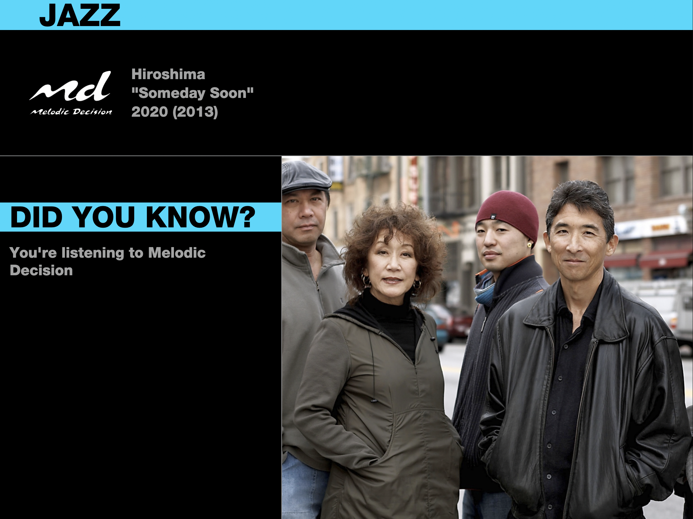
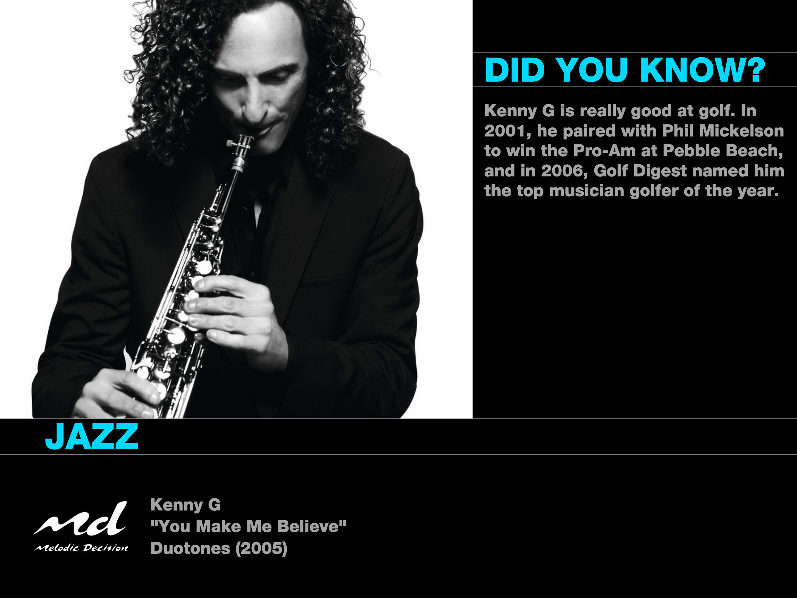
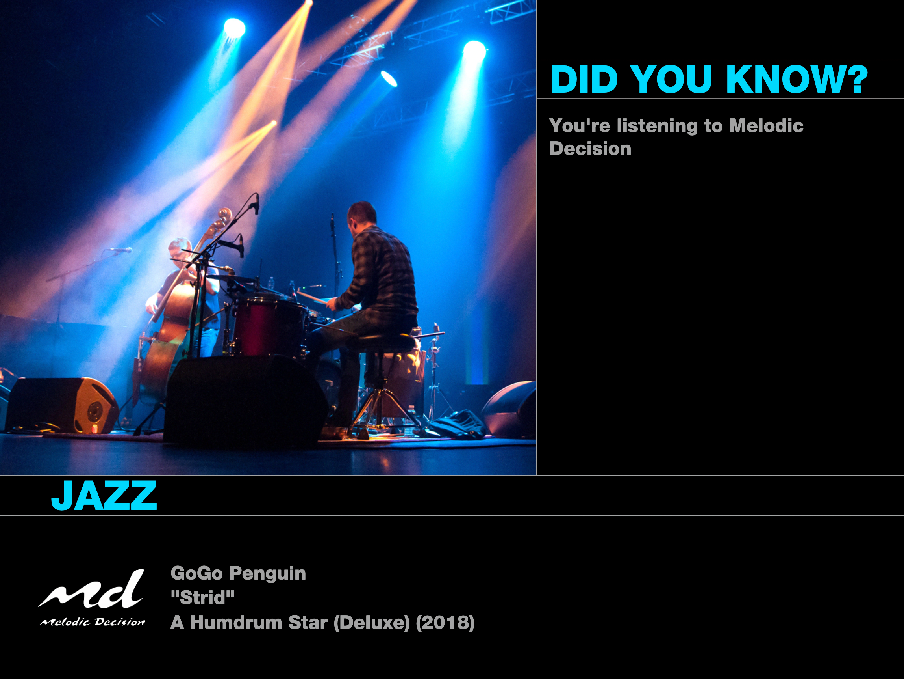
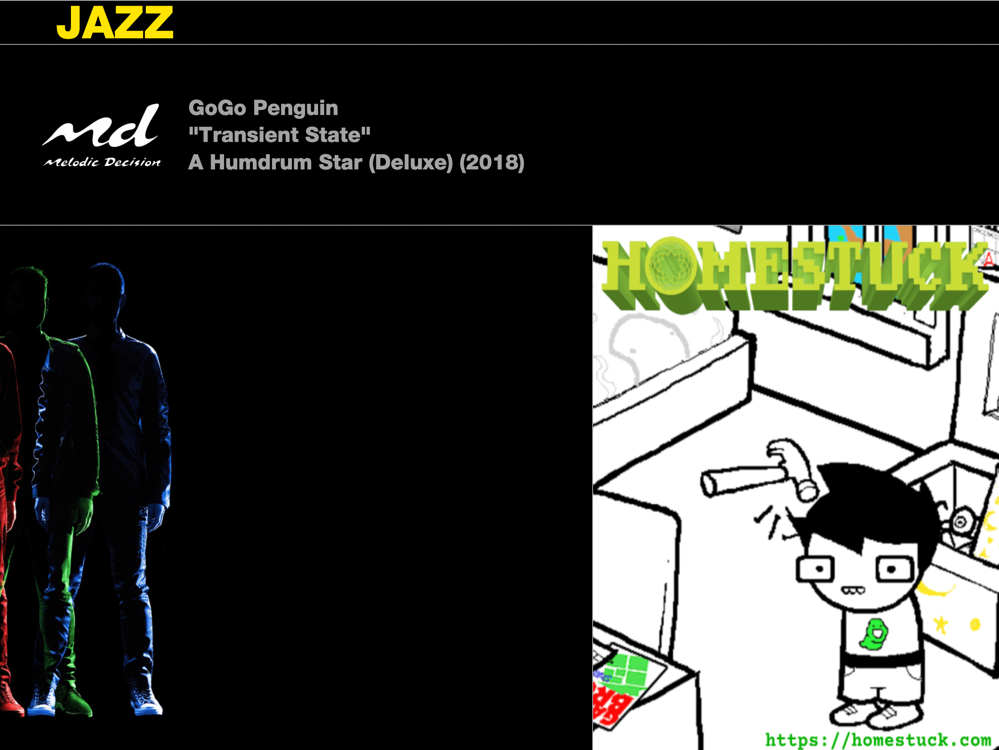

# Melodic Decision


Melodic Decision is a replica of the [Music Choice](https://en.wikipedia.org/wiki/Music_Choice) cable TV channel.

# Screenshots





# Installation
# Using Docker (recommended)
Use the following Docker Compose configuration:

```yaml
services:
  db:
    image: postgres
    environment:
      POSTGRES_USER: melodic
      POSTGRES_PASSWORD: yourPassw0rdh3re
      POSTGRES_DB: melodic
    ports:
      - "5432:5432"
      
  melodic:
    build: https://github.com/floppituna/melodic-decision.git
    ports:
      - "3000:3000"
    environment:
      MD_POSTGRES_URL: postgresql://db:5432/melodic
      MD_POSTGRES_USER: melodic
      MD_POSTGRES_PASSWORD: yourPassw0rdh3re
    depends_on:
      - db
```
> [!IMPORTANT]
> Do not use the example password (MD_POSTGRES_PASSWORD).

Once `melodic` is up, you can visit the administration interface at `http://DOCKER_HOST_IP:3000/admin`.

# Configuration
> [!IMPORTANT]
> **Melodic Decision does not come with any audio material whatsoever.** You are responsible for sourcing the music you wish to play.

> [!NOTE]
> Configuration of Melodic Decision is still quite messy. Expect a lot of changes here as the project matures.

## Adding a Music Source
Since Melodic Decision comes with no music, you'll have to add your own Source. In the sidebar, click **Source Configuration**.

The following sources are currently supported.
- Local Folder
    - ```json
        {
            "folderPath": "/home/nepeta/Music/EpicMix_Final_FINAL_2009"
        }
        ```
- Jellyfin
     - ```json
        {
            "server": "http://192.168.x.x:8096"
        }
        ```

> [!NOTE]
> When a source is added, Melodic Decision will automatically create **Fact Pools** for each artist found, and auto-fill them with facts taken from their page on [Songfacts](https://www.songfacts.com/). These facts will automatically be used when their songs are playing in a broadcast. For more information, see ["Creating a Fact Pool"](#creating-a-fact-pool).

## Creating a Playlist
Playlists are the lists of songs that Melodic Decision can use in broadcasts. To create one, click **Create New Broadcast** in the sidebar.

Once you've made a playlist, you can enter SQL queries to add songs to it. For example, if you wanted to add every song by `Kenny G`, you'd add:

```sql
artists.name = 'Kenny G';
```

Some more examples:

- Every song that the server knows of:
    ```sql
    1=1
    ```
- Every song with "q" in the name:
    ```sql
    1=1 AND albums.title LIKE '%q%'
    ```

## Creating a Broadcast
Broadcasts are the actual "channels" that Melodic Decision will provide. To create one, click **Create New Broadcast** in the sidebar. Make sure you associate it with the playlist you wish to pull music from.

> [!NOTE]
> **Playlists and Broadcasts seperate?**

# Broadcasting
> [!CAUTION]
> **Do not livestream or broadcast music you do not have the rights to transmit.** Melodic Decision is not responsible for any legal fees incurred, or copyright mafia bosses encountered.

## Setting up the Streamers
My recommended setup is to use MediaMTX as a media proxy. Add the following to your docker-compose:

```yaml
services:
  mediamtx:
    image: bluenviron/mediamtx:1-ffmpeg
    ports:
      - "8554:8554"
      - "1935:1935"
      - "8888:8888"
      - "8889:8889"
    volumes:
      - /opt/mediamtx.yml:/mediamtx.yml

  # Individual streams below...
  mdjazz:
    build: https://github.com/floppituna/bstream.git
    environment:
      URL: http://melodic:3000/broadcastv2/default-jazz # change the name at the end to whatever broadcast you'd like to use
      STREAM: mdjazz # this will be 
    depends_on:
      - mediamtx
      - melodic
```

Then, you can direct whatever IPTV application you use to MediaMTX's RTSP (or etc.) stream for each broadcast.

### ErsatzTV
In the folder that you store your [Remote Stream](https://ersatztv.org/docs/media/local/remotestreams/) definitions, add the following:
```yaml
url: "rtsp://DOCKER_HOST_IP:8554/live/mdjazz" # or whatever you put inside of STREAM in your docker-compose
is_live: true
duration: 24:00:00
```
Name the file something you'll recognize, like "MD_Jazz.yml".

### TVHeadend
todo

# Supported Designs
## Ascii1998
Based off of this [VCR recording of Music Choice](https://www.youtube.com/watch?v=socQ175pYQg), taken in 1998. It's currently unknown when this design was truly released, and in what capacity.

## Bold2012
Based off of the [Music Choice's "Bold New Look"](https://www.youtube.com/watch?v=UaG491KlhXY), released in 2012. This particular design was one of the longest running ones, used up until Music Choice's [November 2021 redesign](https://www.instagram.com/musicchoice/p/CWEd3rZPsJV/?img_index=1).


# Contributions
Contributions to this project are very welcome! Please feel free to send in issues if you have problems or feature requests, or pull requests if you'd like to contribute! =D

# Credits
Of course, big thanks to Music Choice, for making a damn good 24/7 music channel to have fond memories of seeing on the TV at my grandma's house. =P

Thank you to [@Cat6a-debug](https://github.com/Cat6a-debug) for making the Melodic Decision logo.